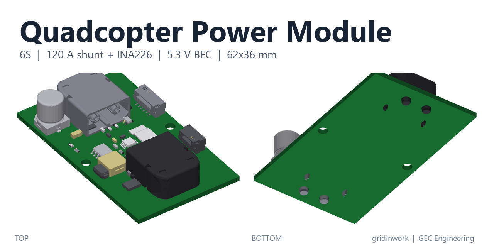
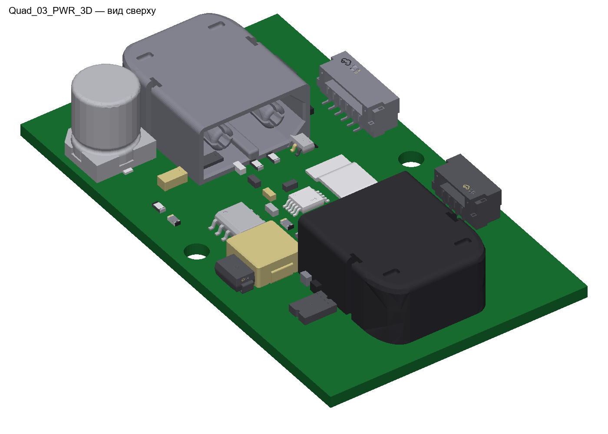
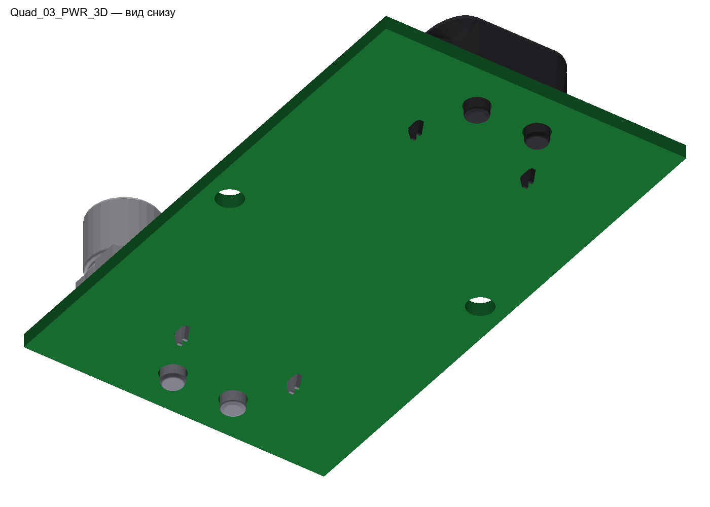
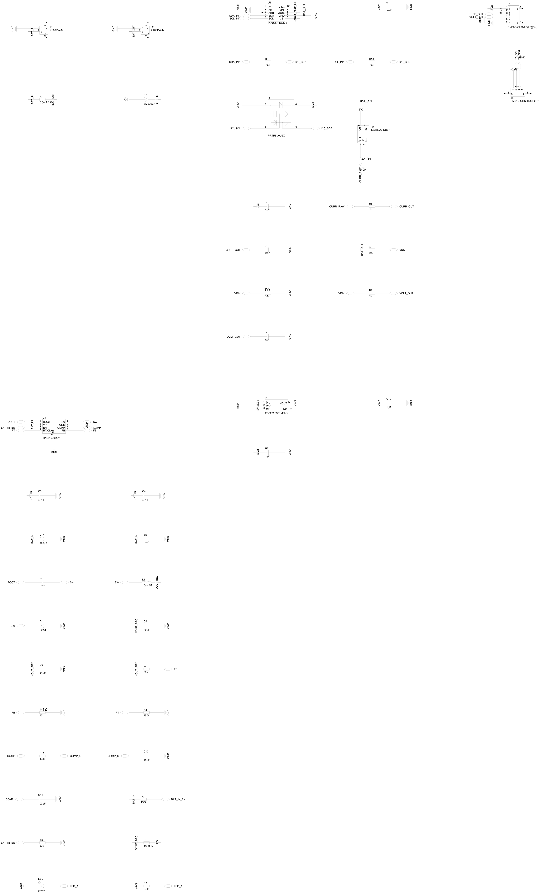
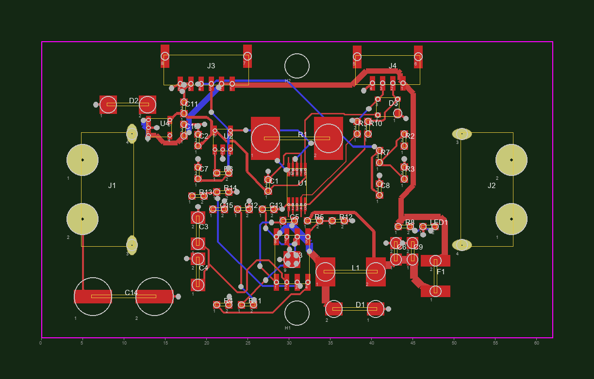

# Quadcopter Power Module (6S, 120 A) with Current Sensor

Inline power module between a 6S battery and the ESCs/PDB of a quadcopter. It measures battery **voltage and current**, sends the data to the flight controller over **I2C (INA226)** and as a **Pixhawk-style analog signal** (backup), and supplies the flight controller and peripherals from a **5.3 V / 3 A** buck converter. **62 x 36 mm**, 2-layer PCB, 2 oz copper.

## Highlights

| Block | Part |
|---|---|
| Power connectors | 2 x XT60PW-M (in / out) |
| Shunt | 0.25 mOhm 3920, >= 3 W, Kelvin connection (specified in the BOM: EB390M25PCFGT) |
| I2C monitor | INA226AIDGSR, address 0x40 (ArduPilot `BATT_MONITOR = 21`) |
| Analog current | INA180A2 (50 V/V): 120 A -> 1.5 V |
| Analog voltage | 100 k / 10 k 0.1 % divider (11:1) |
| BEC | TPS54560 (60 V / 5 A) -> 5.3 V, 3 A, 15 uH coil |
| Protection | SMBJ33A at the input, 5 A fuse on the BEC output, ESD on I2C |
| To flight controller | JST-GH 6p POWER (VCC, VCC, I, V, GND, GND) + 4p I2C |

Designed to work with the [STM32H743 flight controller](https://github.com/gridinwork/STM32H743-Flight-Controller-ArduPilot).

## Status (work in progress)

- Schematic complete, PCB fully routed (all nets connected) - copper pours and DRC in the EasyEDA GUI are still to be done.
- **The shunt footprint in the current EasyEDA design is a 0.5 mOhm placeholder.** The BOM and documentation specify 0.25 mOhm (LCSC C55591764) for 120 A - fix the footprint/value before ordering and recalibrate the INA226 accordingly.
- The board has not been manufactured or tested. High-current layout (trace widths, thermal behaviour of the shunt) must be verified by the builder.

## Gallery

| 3D (top) | 3D (bottom) |
|---|---|
|  |  |

| Schematic | PCB layout (current state) |
|---|---|
|  |  |

## Repository layout

| Path | Content |
|---|---|
| `hardware/EasyEDA/` | EasyEDA Pro project (`.epro2`), schematic and PCB PDF/PNG, 3D STEP model with components, netlist, BOM and CPL (JLCPCB format) |
| `images/` | 3D renders (top/bottom), schematic and PCB previews |
| `docs/` | Design documentation: requirements, pin map, BOM notes, full board description (**written in Russian**) |

## How to open the design

1. Install [EasyEDA Pro](https://pro.easyeda.com/) (free).
2. *File -> Import -> EasyEDA Pro* and select `hardware/EasyEDA/Quad_03_PWR.epro2`.
3. The 3D model (`*_3D.step`) opens in any CAD (SolidWorks, Fusion, FreeCAD, Blender with a STEP importer).

## Bill of materials

Parts are chosen from the LCSC/JLCPCB catalogue (LCSC numbers are in `hardware/EasyEDA/*_BOM.xlsx` and `docs/BOM.md`). Stock levels change daily - **re-check availability before ordering**. `*_CPL.xlsx` is the pick-and-place file for JLCPCB assembly.

## License

Hardware (schematic, PCB, 3D model, documentation): **CERN-OHL-P-2.0** (see `LICENSE`).

Part of the [DIY Quadcopter Hardware](https://github.com/gridinwork/DIY-Quadcopter-Hardware) project by Oleg Gridin, GEC Engineering.
